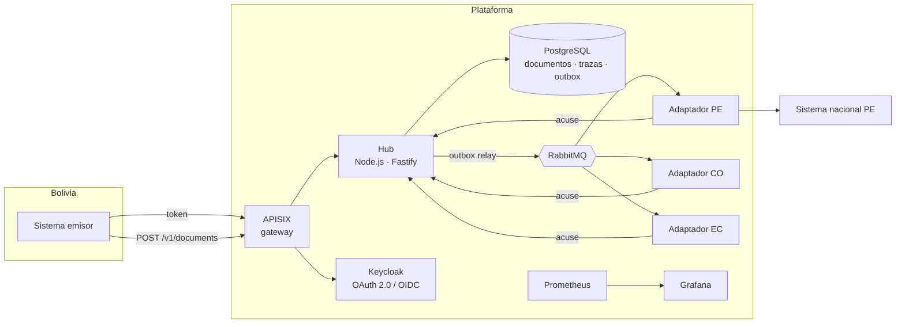

# mini-INTERCOM

Plataforma de interoperabilidad de referencia para el intercambio de documentos electrónicos de comercio exterior entre entidades de distintos países. Reproduce a pequeña escala los problemas de una plataforma real de este tipo: identidad de cada entidad, validación de documentos contra esquemas, mensajería confiable con reintentos, trazabilidad de cada documento, observabilidad, respaldos y despliegue declarativo.

> Proyecto personal y demostrativo. Los esquemas son simplificados y no corresponden a ningún formato oficial.

## Qué hace

Una entidad (por ejemplo, la que emite certificados de origen en Bolivia) envía un **certificado de origen** en JSON o XML. El hub:

1. Autentica a la entidad con **OAuth 2.0 client credentials** (Keycloak) y toma su país y código de entidad del token, nunca del cuerpo.
2. Valida el documento contra su esquema versionado: **JSON Schema** para JSON y **XSD** para XML.
3. Lo guarda junto con su mensaje de salida en una misma transacción (**outbox transaccional**), así no se pierde aunque el broker esté caído.
4. Lo publica en **RabbitMQ** hacia la cola del país destino.
5. El adaptador del país destino lo entrega a su sistema nacional y responde **aceptado** o **rechazado**. Si el sistema nacional falla, reintenta con espera y, al agotar los intentos, lo manda a una cola de mensajes muertos. El hub marca entonces el documento como **FAILED** y dispara una alerta.

Cada cambio de estado queda en una traza consultable por las dos partes:

```
RECEIVED (senavex-bo) -> ROUTED (hub) -> ACCEPTED (vuce-pe)
```

## Arquitectura



Detalle en [docs/arquitectura.md](docs/arquitectura.md) y decisiones en [docs/adr](docs/adr).

## Stack

| Área | Tecnología |
|---|---|
| Servicios | Node.js 22, TypeScript, Fastify |
| Validación | JSON Schema 2020-12 (Ajv), XSD (libxml2 vía WebAssembly) |
| Identidad | Keycloak, OAuth 2.0 client credentials, JWT con JWKS, roles por entidad |
| Gateway | Apache APISIX (modo declarativo): ID de correlación, límite de peticiones, métricas |
| Mensajería | RabbitMQ: colas quorum por país, reintentos con TTL, cola de mensajes muertos |
| Datos | PostgreSQL 17, migraciones versionadas, outbox transaccional |
| Observabilidad | Métricas Prometheus, alertas, tablero Grafana, logs JSON con ID de correlación |
| Plataforma | Docker, Helm, Kubernetes / k3s, Argo CD (GitOps), External Secrets |
| CI/CD y seguridad | GitHub Actions y GitLab CI, Trivy, Gitleaks, npm audit, SonarQube, SBOM, Dependabot |

## Probarlo en local

Requisitos: Docker con Compose, `curl` y `jq`.

```sh
docker compose up -d --build
./scripts/demo.sh
```

La demo envía un certificado en JSON a Perú, uno en XML a Colombia (cuyo adaptador falla la mitad de las veces a propósito, para ver los reintentos), un documento inválido y un reenvío con la misma clave de idempotencia.

| Servicio | URL | Acceso |
|---|---|---|
| API (gateway) | http://localhost:9080/v1 | token de Keycloak |
| Keycloak | http://localhost:8080 | admin / admin-dev |
| RabbitMQ | http://localhost:15672 | intercom / intercom-dev |
| Prometheus | http://localhost:9090 | |
| Grafana | http://localhost:3001 | admin / admin-dev |

Las credenciales de este archivo son solo para desarrollo local.

## API

| Método | Ruta | Quién | Para qué |
|---|---|---|---|
| `GET` | `/v1/document-types` | cualquiera autenticado | Tipos y versiones de documento soportados |
| `POST` | `/v1/documents` | rol `documents:send` | Enviar un documento. Acepta `Idempotency-Key` y `X-Correlation-Id` |
| `GET` | `/v1/documents?direction=sent\|received&status=` | rol `documents:send` | Documentos del país, enviados o recibidos |
| `GET` | `/v1/documents/{id}` | origen o destino | Documento con su traza completa |
| `POST` | `/v1/documents/{id}/acks` | destino, rol `documents:receive` | Aceptar o rechazar (con motivo) |

Los errores siguen RFC 9457 (`application/problem+json`) e incluyen todos los errores de esquema encontrados.

## Pruebas

```sh
cd services/hub && npm ci && npm test            # 19 pruebas: validación, seguridad, idempotencia, outbox, ciclo de vida
cd services/entity-adapter && npm ci && npm test # reglas de negocio y política de reintentos
```

## Desplegar en Kubernetes

El chart está en [deploy/helm/mini-intercom](deploy/helm/mini-intercom): hub con réplicas, HPA, PDB y probes; un adaptador por entidad; job de migraciones previo a cada despliegue; NetworkPolicy; contenedores sin root y con sistema de archivos de solo lectura; secretos desde la bóveda con External Secrets.

Argo CD ([deploy/argocd](deploy/argocd)) sincroniza **staging** con `main` automáticamente y **producción** con una etiqueta de versión, dentro de una ventana horaria. Para revertir producción basta con apuntar a la etiqueta anterior.

Para probarlo en un k3s local, ver [docs/runbook.md](docs/runbook.md#desplegar-en-k3s-local).

## Operación

- [Runbook](docs/runbook.md): diagnóstico por trazabilidad, colas que no bajan, documentos fallidos, rotación de secretos.
- [Respaldo y recuperación](docs/respaldo-y-recuperacion.md): `scripts/backup.sh` y `scripts/restore.sh`, con restauración de prueba.
- [Seguridad](docs/seguridad.md): controles DevSecOps aplicados.
- [Modernización de una plataforma existente](docs/modernizacion.md): cómo migrar sin interrumpir el servicio.

## Autor

Felix Adrian Mamani Foronda · [LinkedIn](https://www.linkedin.com/in/mf-fedrian/) · [GitHub](https://github.com/fedrianMF)
