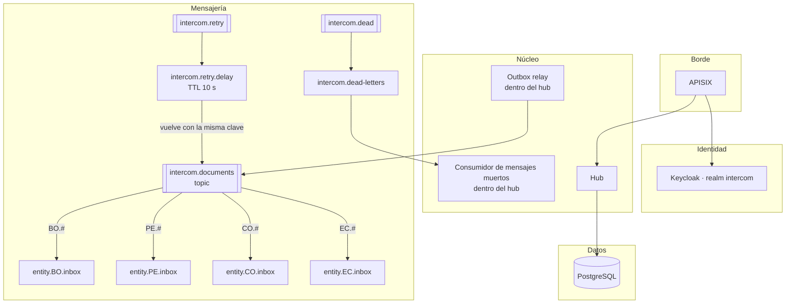
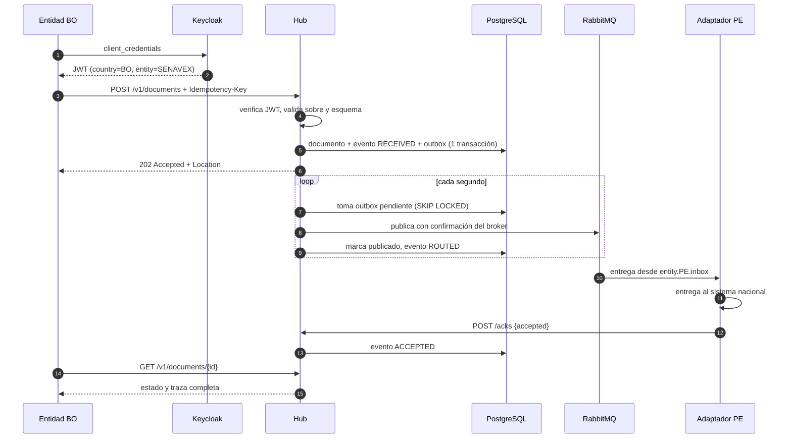
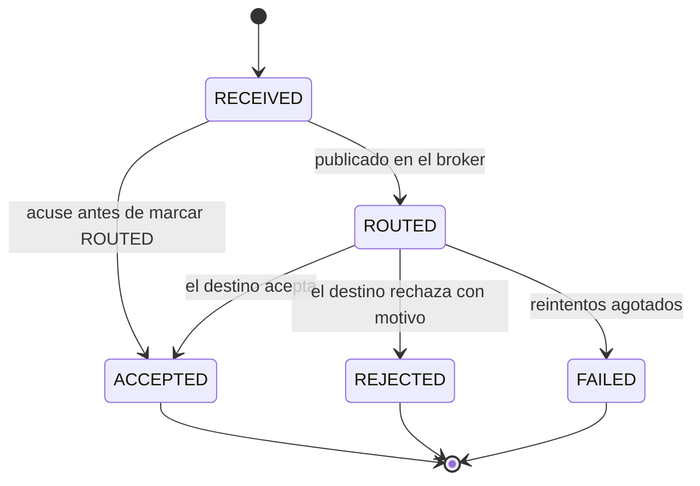

# Arquitectura

## Contexto

Varias entidades públicas de distintos países (entidades certificadoras de origen, ventanillas únicas de comercio exterior, aduanas, agencias sanitarias) necesitan intercambiar documentos electrónicos. Cada una tiene su propio sistema, su propio ritmo de cambios y su propia disponibilidad. La plataforma tiene que:

- Saber con certeza quién envía cada documento.
- Rechazar en la entrada lo que no cumple el formato acordado, con errores que el emisor pueda corregir.
- No perder ningún documento, aunque un componente o un sistema nacional esté caído.
- Poder responder en cualquier momento "¿qué pasó con este documento?".
- Evolucionar los formatos sin romper a quien todavía usa la versión anterior.

## Componentes

| Componente | Responsabilidad |
|---|---|
| **APISIX** | Punto único de entrada. Genera o propaga `X-Correlation-Id`, limita peticiones por origen, expone métricas. No publica `/health` ni `/metrics`. |
| **Keycloak** | Un cliente confidencial por entidad, con *service account*. Cada token lleva `country`, `entity`, la audiencia `intercom-hub` y los roles. |
| **Hub** | API de documentos, validación, persistencia, trazas, outbox relay y consumo de mensajes muertos. Sin estado propio: escala horizontalmente. |
| **PostgreSQL** | `documents` (estado actual), `document_events` (traza de solo inserción), `outbox` (mensajes pendientes de publicar). |
| **RabbitMQ** | Una cola por país, de tipo *quorum* para tolerar la caída de un nodo. Reintentos con retardo y cola de mensajes muertos. |
| **Adaptador por entidad** | Consume la cola de su país, entrega al sistema nacional, responde el acuse y decide reintentar o desistir. |

## Flujo de un documento

## Estados

Los estados finales no cambian. Un acuse repetido con el mismo resultado se acepta sin efecto, y uno contradictorio devuelve `409`.

## Garantías

| Riesgo | Cómo se cubre |
|---|---|
| El broker cae justo después de guardar | Outbox transaccional: el mensaje se publica cuando el broker vuelve. |
| El hub publica y cae antes de marcar | El mensaje puede salir dos veces (*at-least-once*). El acuse es idempotente y el `documentId` permite descartar duplicados en destino. |
| El emisor reintenta el POST | `Idempotency-Key` única por entidad: devuelve el documento existente con `200`. |
| El sistema nacional está caído | Reintentos con retardo; al agotarlos, cola de mensajes muertos, estado `FAILED` y alerta. Nada se descarta en silencio. |
| Una entidad suplanta a otra | El origen sale del token firmado. Solo origen y destino ven un documento; solo el destino puede acusarlo. |
| Varias réplicas del hub | `FOR UPDATE SKIP LOCKED` reparte el outbox; las migraciones usan un *advisory lock*. |

## Versionado de esquemas

Cada tipo de documento vive en `schemas/<tipo>/v<n>/` con su JSON Schema y su XSD. El hub carga todas las versiones al iniciar y el emisor declara `schemaVersion`. Publicar una versión nueva es agregar una carpeta: las entidades migran a su ritmo y la versión anterior se retira cuando ya nadie la usa (lo muestra la métrica por tipo y versión).
