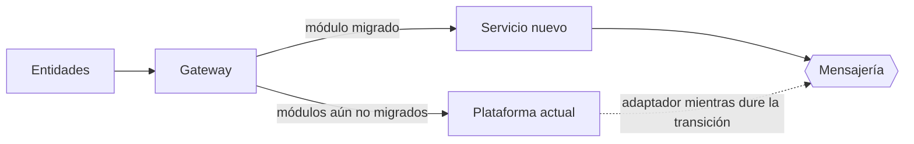

# Modernizar una plataforma en producción sin cortar el servicio

Guía de cómo llevaría una plataforma de interoperabilidad existente hacia una arquitectura como la de este repositorio, sin interrumpir a las entidades conectadas. Es una propuesta general, no la descripción de ninguna plataforma real.

## Principios

1. **Primero visibilidad.** Antes de cambiar nada: inventario de componentes, diagramas, dependencias, credenciales y vencimientos, y métricas básicas del intercambio. Sin línea base no se puede demostrar que la migración no empeoró nada.
2. **El contrato con las entidades no cambia.** URLs, formatos y credenciales siguen iguales durante la transición. Lo que cambia es lo que hay detrás.
3. **Cambios pequeños y reversibles.** Cada paso se puede revertir en minutos, se despliega por GitOps y queda trazado en Git.
4. **Un módulo o un país a la vez.**

## Pasos

### 1. Estabilizar y documentar

- Llevar la configuración actual a Git y desplegarla de forma declarativa, aunque el código no cambie todavía.
- Centralizar logs y métricas, con un ID de correlación de extremo a extremo.
- Respaldos con restauración probada y calendario de vencimientos de certificados, licencias y credenciales.
- Runbook de las incidencias más frecuentes, para que más de una persona pueda operar cada componente.

### 2. Poner un gateway delante

Todas las entidades pasan a entrar por un gateway que, al principio, solo reenvía al sistema actual. Desde ese momento hay un único lugar para enrutar, limitar, medir y, más adelante, decidir qué tráfico va al componente nuevo.

### 3. Patrón *strangler fig*

- Se elige el módulo de menor riesgo y se reimplementa detrás del gateway.
- **Tráfico en sombra:** el gateway duplica peticiones reales hacia el servicio nuevo sin que su respuesta llegue a la entidad, y se comparan los resultados.
- **Canario:** se mueve una entidad o un porcentaje pequeño, se observa, se amplía.
- **Reversa inmediata:** volver a enrutar al sistema anterior es un cambio de configuración en el gateway.

### 4. Datos

- Esquema nuevo con migraciones versionadas y que solo agregan, para que versión vieja y nueva convivan.
- Mientras convivan, una sola fuente de verdad por módulo; nunca dos sistemas escribiendo lo mismo.
- Conciliación diaria entre ambos hasta apagar el anterior.

### 5. Apagar lo anterior

Cuando un módulo lleva un ciclo completo sin incidencias atribuibles a la migración y la conciliación cuadra, se retira su ruta antigua, se archivan sus datos según la política de retención y se actualiza la documentación.

## Supervisión de proveedores durante la migración

- Criterios de aceptación escritos antes de empezar cada entrega: pruebas automatizadas, cobertura mínima, escaneo de seguridad limpio, documentación y runbook actualizados.
- Revisión de código por pull request antes de integrar.
- Despliegue primero en staging con las pruebas de certificación de las entidades.
- Informe técnico de conformidad por entrega, con evidencias (pipeline, resultados de pruebas, métricas en staging).
